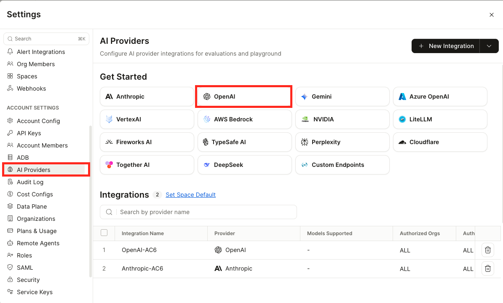
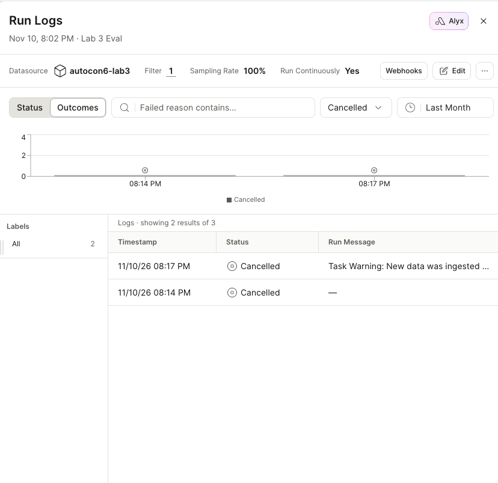
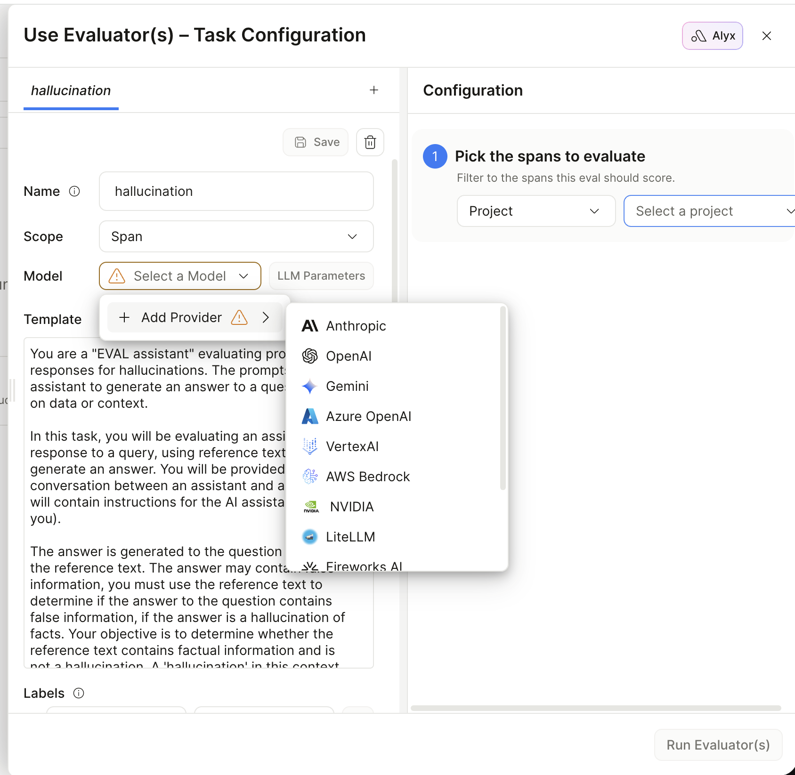

# Lab 5: Application Evaluation with Arize AX

**Time:** ~35 minutes hands-on, plus 5 minutes of reading at the end

You've built a network co-pilot: a parser with a contract (Lab 2), an agent that uses it (Lab 3), a UI that shows its work (Lab 4), and every run of it traced into Arize AX since Lab 3 Step 5. One question is left, and it's the one your manager will ask: **is it right, and how do you know?**

This lab builds nothing new. It evaluates, in three moves you make and one you read about:

1. **Read the traces** you've already produced, and learn the five words Arize uses for them.
2. **Run your first experiment, in the Arize UI.** Four questions about our lab network, one prompt, one LLM judge. Two answers fail. You change the prompt, run it again, and compare the two runs.
3. **Run the same loop from code, on the agent you built.** Six questions, two of them traps that invite the agent to make something up.
4. **See what this looks like in production** — online evals on live traffic, and Alyx — as a five-minute read with screenshots, not a click-through.

Steps 1–3 are the lab. Step 4 is reading. **Going Further** has more of each for anyone with time left: the parser scored by a code evaluator and an LLM judge side by side, a judge's rubric changed by one sentence, and the production features as hands-on walkthroughs.

> **Two things to know before you click.** Step 2 is done in Arize's web UI, and Arize ships UI changes weekly. The button and tab names below are what Arize's own tutorial and our walk-through of it showed on 12 November 2026; when yours differ, the concept is the same — look for the nearest label, and ask if it isn't obvious. (If a dialog has moved beyond recognition, the end of Step 2 has a script that runs the same experiment.) And every result quoted as *"when we ran it"* is one run: models and LLM judges are not deterministic, so yours may differ a little from ours and from your neighbour's. That variance is part of what this lab teaches.

## Prerequisites

- Labs 3 and 4 run at least once **with tracing on** (`[tracing] exporting to Arize AX project …` in the terminal). If you skipped that, run `python Lab_3_LangChain_Network_Agent/agent.py` now; it takes 30 seconds and gives you four traces to look at.
- `ARIZE_SPACE_ID` and `ARIZE_API_KEY` in `.env`.
- Your **OpenAI API key** within reach (it's the `OPENAI_API_KEY` line in `.env`). Step 2 asks you to add it to your own Arize space, so that Arize's playground and its judge can call `gpt-6-luna` on your behalf. Step 2a shows where it goes and what that means. The judge in Step 3 runs in your Codespace on the key in `.env`, like every lab so far.

## Concepts

- **Trace → eval → experiment.** A trace records what happened. An eval attaches a judgement to it. An experiment runs a *task* over a *dataset* and scores every row — the thing you do before you ship a change.
- **Code evaluators and LLM judges.** When you have an answer key and a structured output, compare in code: exact, cheap, deterministic. When the output is prose, a second model grades it against the reference. Lab 2 built the first kind; today adds the second.
- **Online versus offline.** An online eval scores production traffic as it arrives. An experiment scores a fixed dataset on demand. You need both: the first tells you *what's happening*, the second tells you *whether a change helped*. Today you build the second and read about the first.
- **Hallucination is testable.** Ask about something that doesn't exist. A correct agent says so. The judge checks that it did.

---

## Step 1: Read the traces — the vocabulary, on screen

Open [app.arize.com](https://app.arize.com) → **Projects**. You should see `autocon6-lab3` (from `agent.py`) and `autocon6-lab4` (from the Streamlit app). Open **autocon6-lab4** → **Traces**. (If you only ran Lab 3 with tracing, `autocon6-lab3` has the same shape; use that.)

Each row is one **trace**: one turn of your chat, start to finish. Click the *Compare r1 and r3* one if you asked it, or any row with a tool call.

**What to look at, in order:**

1. **The waterfall.** A trace is a tree of **spans**. A root span for the agent run. Under it, the model call that decided to use the tool. Under that, two tool spans side by side (they ran together). Under each tool span, the parser's own model call. Then the final model call. Every one has a duration bar — notice where the time goes.
2. **The agent graph.** At the top left of the trace are three small view buttons. Click the third. The same trace is redrawn as the shape of the agent: **Start → Model → Tools**, an edge from Tools back to Model, and **Model → End**. You've seen this picture before. It's the Mermaid diagram `graph_agent.py` printed in Lab 3 Step 4: the same two nodes and the same loop. There you had to paste it into mermaid.live to see it drawn; here Arize draws it from the trace of a real run. The waterfall tells you *when* each thing happened. The graph tells you *what the agent is*. Switch back to the view you started in before you carry on.

   

   *The graph view of a "Compare BGP state between r1 and r3" trace, in our space on 12 November 2026. The arrow marks the button that switches to it.*

3. **The span kind.** Each span carries a kind — `AGENT`, `CHAIN`, `LLM`, `TOOL` — shown as a coloured tag. The kind is what you filter on when you want "just the model calls" or "just the tool calls". Count the `LLM` spans in this one trace.
4. **The model spans.** Click an `LLM` one. The exact system prompt and messages sent, the exact response, the token counts in and out. In the attributes panel these are `input.value` and `output.value`. This is what you'd be billed for and what you'd debug with.
5. **The tool spans.** Click a `TOOL` one. Input `{'node': 'r1'}`, output the text the tool returned — again `input.value` and `output.value`. If the agent ever answers wrong, this is where you learn whether the tool fed it bad data or the model misread good data.
6. **The final model span.** Click the last `LLM` span in the trace and look at its `input.value`. It holds the whole conversation so far, *including the tool output the agent just read*. That's why a judge pointed at this one span can check the answer against the evidence: both are in it.
7. **Sessions.** Lab 4 tagged every turn with its thread ID. If your project view offers a **Sessions** tab, open it: a session is a whole conversation, turn by turn, in order. Find the one where you asked *"…and r2?"* and see the context it resolved against. (If you don't see a Sessions tab, skip this — it's a view, not a concept.)

Now flip to **autocon6-lab3** and look at the local-model run if you did Lab 3 Step 7 (`--local`). Same shape, model spans twenty times longer. Same tool spans. The trace makes "slower" a number.

**Hold on to this:** an evaluator has no hidden data. The online evaluators you'll read about in Step 4 work on exactly the fields you just clicked on: a span's `input.value` and `output.value`, selected by span kind. The ones you run in Steps 2 and 3 work on the same two things under other names — what went in, and what came out. The evaluator sees what you see.

---

## Step 2: Your first experiment — prove a prompt change helped

An **experiment** has three parts: a **dataset** (fixed questions with known-good answers), a **task** (the thing being tested — here, a prompt) and an **evaluator** (whatever decides if each answer was right). Run the task over the dataset, score every row, change one thing, run it again, compare. That loop is how you find out whether a change helped *before* you ship it.

This step follows Arize's own tutorial, [Run evals on experiments](https://arize.com/docs/ax/get-started/get-started-improve-your-agent), with our lab network in place of their airline. All of it happens in the browser, at [app.arize.com](https://app.arize.com).

### 2a. Connect a model provider

The playground has to call a model to answer the questions, and the judge has to call one to grade them. Arize doesn't supply that model on the free tier: it calls **your** provider, with a key stored in your space. So the first thing to do is give it one.

1. In Arize, open **Settings**. In its left-hand menu, under **Account Settings**, click **AI Providers**.
2. Under **Get Started**, click **OpenAI**.
3. Give the integration a name (we called ours `OpenAI-AC6`) and paste your OpenAI API key, the same one that is in your `.env`.
4. Tick the terms checkbox and click **Add Integration**.



*Settings → AI Providers → OpenAI, in our space on 12 November 2026. Once you've added yours, it shows up in the **Integrations** list at the bottom.*

If you skip this step, you'll find out in 2c: a model dropdown with no provider behind it offers only **Add Provider**, which leads to the same form.

> **About that key.** It is stored in *your* Arize space, and from here on the playground and any evaluator you create there spend from your OpenAI credit; this lab costs a few cents. When you're done with it, delete the integration with the trash-can icon at the end of its row on this same page, or revoke the key at [platform.openai.com/api-keys](https://platform.openai.com/api-keys), which cuts Arize off whatever else happens. If you'd like to be able to revoke it without breaking your `.env`, create a second key for Arize now and paste that one instead.

### 2b. Create the dataset

The dataset is `noc-questions.csv`, in this lab's folder. Four rows, two columns:

| question | expected_answer |
|---|---|
| What TCP port does BGP use? | BGP uses TCP port 179. |
| Which interface on r1 connects to r3? | r1 connects to r3 on interface ethernet-1/2. |
| Which AS number is r3 in? | r3 is in AS 65002. |
| Which NTP server do our routers use? | This is not documented. A correct answer says it does not know and does not name an NTP server. |

Each row is there for a reason:

- **Row 1 is the control.** Any model knows it. If the judge marks this one wrong, the problem is the judge, not the prompt.
- **Rows 2 and 3 are ours.** They are true of the three routers in your Codespace and of nothing else. No model was trained on your network.
- **Row 4 is a trap.** Nobody wrote the NTP server down, so the right answer is "I don't know". It's there to catch a change that makes the model *too* willing to answer.

Arize wants the file from your laptop, so download it first:

1. On the repo's GitHub page (the one you launched your Codespace from), open [`Lab_5_Evaluation_Arize_AX/noc-questions.csv`](noc-questions.csv) and click the **Download raw file** button, the down-arrow icon at the top right of the file view. (Or, from the Codespace: right-click the file in the **Explorer** → **Download…**.)
2. In Arize: **Datasets → New Dataset → Upload CSV**. Name it `autocon6-noc-questions`, add the file, and click **Create Dataset**.

(If the download or the upload fights you, `python Lab_5_Evaluation_Arize_AX/run_noc_experiment.py --dataset-only` creates the same dataset from your Codespace. Carry on at 2c.)

### 2c. Set up the baseline prompt

1. Go to **Playgrounds**. (If you land on a list instead of an editor: **New Playground**, and choose the prompt playground.)
2. **Select a Dataset** → `autocon6-noc-questions`. Its columns become variables you can use in the prompt, such as `{question}`.
3. In the model picker choose **OpenAI** and **`gpt-6-luna`**, the model you've used all afternoon.
4. Use this as the **user** prompt:

   ```
   You are a NOC engineer. Answer the user's question.

   Question: {question}
   ```

`{question}` is filled in from the dataset, once per row: four rows, four calls to the model. Notice what the prompt does *not* contain, which is anything about our network.

Don't click Run yet. It needs a judge first.

### 2d. Add the judge and run

You could read four answers and grade them yourself. You couldn't read four thousand. So a second model does the grading, against the answer key.

1. Click **Add Evaluator → New Evaluator** and pick the **Q&A** template. It labels each answer `correct` or `incorrect` against reference data.
2. If the evaluator asks for a model, give it `gpt-6-luna` as well.
3. Under **Map Variable to Data**, connect the template's three variables to your data:

   | Template variable | Map to |
   |---|---|
   | `question` | the `question` column |
   | `input` | the `expected_answer` column |
   | `output` | the experiment's output |

   The middle row is the one to get right. In this template `input` means *the reference text the answer is checked against*, and for us that is the answer key.
4. Save the evaluator (we named ours `noc-engineer-qa`) and click **Run**.

Four answers stream in, then a label under each one. Click **View Experiment**, and hover over a label to read the judge's reasoning.


*The baseline run in our space on 12 November 2026. **Avg noc-engineer-qa: 0.5** in the header is the score: two correct out of four. Our playground is named `noc-engineer` and our dataset is listed under its file name; yours show the names you gave them.*

**Expected, when we ran these four rows on 12 November 2026:**

| Question | Label | What the model answered |
|---|---|---|
| Which AS number is r3 in? | `incorrect` | *I can't determine r3's AS number without the network topology or configuration. Please share the relevant details.* |
| Which interface on r1 connects to r3? | `incorrect` | *I can't determine that without the network topology or r1's interface configuration. Share the relevant interface or neighbor output, and I can identify it.* |
| What TCP port does BGP use? | `correct` | *BGP uses TCP port 179.* |
| Which NTP server do our routers use? | `correct` | *I can't determine that from the information available here. On a Cisco router, check `show running-config \| include ntp` or `show ntp associations`; share the output and I can identify the server…* (cut off in the screenshot above; you can see it in the comparison in 2f) |

Arize listed the rows in its own order, not the file's, and its **Input Variables** column showed placeholder text instead of the question. Go by the answers, not the row numbers.

Two out of four. Now read the two `incorrect` answers again, because the model didn't say anything false. It said it can't know which interface faces r3, and it's right: nobody told it. The judge marked those rows incorrect because the answer key holds a fact the answer doesn't. **The model isn't broken. The prompt is missing something.** That's a different diagnosis from "the model is bad at networking", and it's the judge's explanation that lets you tell the two apart.

The NTP question passed for the same reason the two about our network failed: the model said it doesn't know. On that row, not knowing *is* the right answer.

### 2e. Add the facts and run it again

Give the model what it was missing. In the **same** user prompt, add the network's facts between the two lines you already have, so that it reads:

```
You are a NOC engineer. Answer the user's question.

Our network:
- r1 and r2 are in AS 65001 and run iBGP between their loopbacks, 10.0.0.1 (r1) and 10.0.0.2 (r2).
- r3 is in AS 65002 and runs eBGP with r1.
- r1 connects to r2 on ethernet-1/1 (10.1.12.1/30).
- r1 connects to r3 on ethernet-1/2 (10.1.13.1/30). r3's end of that link is 10.1.13.2.

Question: {question}
```

The dataset, the model and the judge stay exactly as they were. Click **Run** again. Because nothing else moved, any change in the scores comes from those five lines.

**Expected:** four `correct` when we ran it, and the average in the header goes from 0.5 to 1. The two questions about our network flip: *r3 is in AS 65002*, *r1 connects to r3 on ethernet-1/2*. The BGP port question is still correct, so the extra text didn't distract the model from what it already knew. And the NTP question is still correct: with a block of network facts in front of it and a question those facts don't cover, the model answered *"The NTP server can't be determined from the information provided. The BGP and interface details don't specify NTP configuration."* instead of inventing one.


*The second run in the same playground, 12 November 2026: the facts block is in the prompt, the header reads **Avg noc-engineer-qa: 1**, and **Run History** at the top right has gone from 1 to 2.*

### 2f. Compare the two runs

Each click of Run created an **experiment** on the dataset, so the two are stored side by side.

1. Open **Datasets → `autocon6-noc-questions`** and go to its **Experiments** tab. You should see two runs.
2. Tick both and click **Compare Experiments**.
3. Turn on **Diff Mode** and make the first run, the one with the earlier time, the baseline.

**Expected:** the same four questions down the left, one column of answers per run, and the judge's label under each answer. Each column is headed with the run's name, which is `Playground -` plus the date and time you clicked Run, and with its average score. When we did this, the first run moved to the left with a **Baseline** tag and an average of 0.5. The second run sat on the right with an average of 1 and **↑ 2 ↓ 0** beside it: two rows scored better than the baseline and none scored worse. Two rows changed from `incorrect` to `correct`. Two rows didn't change, and they matter as much as the two that did: the BGP port question says the fix broke nothing, the NTP question says it didn't make the model overconfident.

![Arize's Compare Experiments view for the noc-questions.csv dataset with Diff Mode switched on. The left column lists the questions. The next column is run #1, "Playground - 11/12/26, 5:57:06 PM", tagged Baseline, with "Avg noc-engineer-qa 0.5". The column after it is run #2, "Playground - 11/12/26, 5:58:59 PM", with "Avg noc-engineer-qa 1" followed by a green up arrow 2 and a red down arrow 0. For "Which AS number is r3 in?" and "Which interface on r1 connects to r3?", the baseline says it can't determine the answer and is labelled incorrect in red, while run #2 answers with the fact and is labelled correct in green. For "What TCP port does BGP use?" both runs answer 179 and both are labelled correct](images/compare-experiments.png)

*Our two runs in Diff Mode on 12 November 2026: the baseline on the left, the run with the facts on the right. The green **↑ 2** and red **↓ 0** in its header count the rows that improved and the rows that got worse. This view shows each question in full, which the playground didn't, so you can read across a row. The asterisks around `ethernet-1/2` and `179` are the model's bold markup, shown here as typed.*

![The same comparison scrolled down, with a red box drawn around the row "Which NTP server do our routers use?". The baseline answers "I can't determine that from the information available here. On a Cisco router, check show running-config | include ntp or show ntp associations; share the output and I can identify the server…" and run #2 answers "The NTP server can't be determined from the information provided. The BGP and interface details don't specify NTP configuration. Check each router's NTP configuration or operational status…". Both are labelled correct in green](images/compare-experiments-ntp.png)

*The same view scrolled down to the NTP question (the red box is ours). Neither run names a server, and both are labelled `correct`. The baseline answer suggests Cisco commands although our routers run SR Linux, and it still passes: the answer key for this row only asks that the model say it doesn't know and not name a server.*

**What you just did** is the whole method, small: a fixed set of questions, an answer key, a judge, one change, two runs, a comparison. The fix itself was no surprise, since a model that is told a fact can repeat it. What matters is that you didn't have to take it on trust. You can show anyone which rows moved and which didn't.

**Why not paste the whole network into the prompt?** Five lines covered three routers. Your production network has four thousand devices and it changed last night. That is why Lab 3 gave the agent a *tool*, which fetches the facts live instead of carrying them in the prompt, and why [`bonus/rag`](../bonus/rag/) retrieves documents on demand. Which leaves a question: how do you run this same test on something that isn't a prompt in a text box?

> **If a dialog has moved.** The same experiment runs from your Codespace, with the key in your `.env`:
>
> ```bash
> python Lab_5_Evaluation_Arize_AX/run_noc_experiment.py                  # the baseline prompt
> python Lab_5_Evaluation_Arize_AX/run_noc_experiment.py --prompt fixed   # with the facts added
> ```
>
> Both runs land on the `autocon6-noc-questions` dataset (the script creates it if it isn't there yet), and 2f works on them as written.

---

## Step 3: The same loop from code — on the agent you built

Step 2's task was a prompt in a text box. Your agent isn't one. It's code that decides to call a tool, reads a router, and answers from what it read. So its experiment runs where that code lives, in your Codespace, and it has the same three parts: a dataset, a task, an evaluator.

> **Heads up — the files are already in the repo.** `run_agent_experiment.py` is here in this lab folder, with a shared `arize_common.py`.

Open `run_agent_experiment.py`.

**The dataset** is six questions. Four are normal, each with the facts a right answer must contain. Two are **traps**, like the NTP question in Step 2 but sharper:

```python
    {"question": "What's the BGP state on r4?",
     "expected_facts": "There is no r4 in this topology (only r1, r2, r3). The answer must say so and must NOT describe any sessions for r4.",
     "trap": True},
    {"question": "What is the OSPF neighbor count on r3?",
     "expected_facts": "The agent has no OSPF tool and r3 does not run OSPF. The answer must say it cannot determine this ...; it must NOT invent an OSPF neighbor count.",
     "trap": True},
```

**The task** is Lab 3's `ask()`, unchanged. One dataset row in, the agent's answer out:

```python
def make_task(local: bool):
    agent = build_agent(local=local)

    def answer_task(dataset_row) -> str:
        return ask(agent, dataset_row["question"])

    return answer_task
```

**The evaluator** is an LLM judge again, written as a class this time instead of picked from a template. It gets the question, the expected facts and the agent's answer, and returns `correct`, `hallucinated`, and why:

```python
class JudgeVerdict(BaseModel):
    correct: bool = Field(description="True if the answer contains the expected facts and contradicts none of them")
    hallucinated: bool = Field(description="True ONLY if the answer asserts something the expected facts say does not exist ... Extra accurate detail the expected facts simply don't mention (uptimes, prefix counts, group names) is NOT hallucination.")
    explanation: str
```

An evaluator takes the task's output and the dataset row, and returns a **score, a label and an explanation**: the three things you hovered over in Step 2. The Q&A template was this with a form in front of it. One difference is where it runs. This judge runs in your Codespace, on the key in your `.env`, and uploads only its verdicts.

```bash
python Lab_5_Evaluation_Arize_AX/run_agent_experiment.py
```

(`--dry-run` runs everything locally and uploads no results, which is handy while you're editing an evaluator.)

**Expected:** two yellow `[BETA]` warnings from the SDK (harmless), a progress bar, then six rows, all `correct`, none `hallucination`, including the traps, when we ran it (6/6). If you get 5/6, open the row before you blame the agent: in our experience the miss is the judge over-reading its rubric, and Going Further #2 is about exactly that. Read the judge's explanations on the two traps:

```
The answer correctly says the tool supports only r1, r2, and r3 and does not invent any BGP sessions for r4.
The answer correctly says the available data cannot determine r3's OSPF neighbor count and does not invent a count.
```

Now open **Datasets → `autocon6-agent-questions` → Experiments**, open the run, and read the agent's actual answers on those two rows. They're the most important two sentences the agent produced today, because they're the ones where it chose *not* to make something up. Two earlier-lab decisions made that possible: the tool returns an error string instead of raising (Lab 3 Step 1), and the system prompt tells the agent to use tools for router questions instead of its own knowledge.

In Step 2 a bare model declined because it had nothing to go on. Here an agent with a working tool was asked about a router that doesn't exist, and it still declined. That is the harder case, and it's the one your users will find.

> **Try to break it.** Add a seventh question to `QUESTIONS` with a plausible-sounding falsehood baked in — *"Why is r2's eBGP session to r3 flapping?"* (r2 has no session to r3). Re-run with `--name agent-trap-7`. Does the agent push back, or explain a session that doesn't exist? The judge will tell you, and so will the trace.

---

## Step 4: What this looks like in production — read, don't click

Everything you did in Steps 2 and 3 you chose: the rows, the moment, the judge. In production the questions come from users, at 3 p.m. on a Tuesday, and nobody is running a script. Arize has features for that. We built and ran them while writing this lab, and the screenshots below are from our space on 10 November 2026. This part is a read because it's the end of a long afternoon, because these particular dialogs changed twice in the week before the workshop, and because nothing in them is new to you any more. The steps, as they worked for us, are in **Going Further**.

### Online evals: the same judge, on every new trace

An **online eval** is an evaluator attached to a project. Every new span that matches a filter gets scored as it lands — label, score, explanation, written onto the span as `eval.<evaluator name>` — and you see the labels in the same Traces view you used in Step 1.


Look at what's in the dialog, because you've already met every piece of it:

- **Left**: a judge. A prompt template with `{input}`, `{context}` and `{output}` placeholders; two labels, `hallucinated` = 1 and `factual` = 0; a direction (minimize). It's the evaluator you configured in 2d with a different template, and it's `JudgeVerdict` from Step 3 written as a form instead of a class. It runs on the provider you connected in 2a.
- **Right, step 1**: which spans. A project (`autocon6-lab3`) and a filter, `attributes.openinference.span.kind equals LLM` — the span kind from Step 1, item 3. The table underneath is the matching spans, the ones named `ChatOpenAI`.
- **Right, step 2**: the mapping. `{input}` → the span's `input.value`, `{output}` → its `output.value`. That's 2d's *Map Variable to Data*, with span fields where the dataset columns were. The final model span's input holds the tool output (Step 1, item 6), which is why a hallucination judge can work on it with no answer key.

Then **Run**, and the task keeps running. Its history looks like this:



Two rows there say *Cancelled*. That's not a failure: a continuous task that is edited mid-run, or that sees new spans arrive while a run is in flight, abandons that run and schedules a fresh one. Reading a run log is the production version of reading the scores in Step 2.

Going Further #3 builds this one.

Docs: [Build evals](https://arize.com/docs/ax/evaluate/create-evaluators) · [Run evals on traces](https://arize.com/docs/ax/evaluate/run-evals-on-traces) · [LLM as a judge](https://arize.com/docs/ax/evaluate/evaluators/llm-as-a-judge) · [Results and costs](https://arize.com/docs/ax/evaluate/results-and-costs) · [Online versus offline](https://arize.com/docs/ax/concepts/evaluators/online-vs-offline)

### The playground, pointed at real traffic

You used the playground with a dataset in Step 2. It has a second way in: any model span in a trace can be opened in it, with the exact prompt that was sent, tool results included, and re-run against a different model or an edited system prompt. That is the loop from Step 2 with a real production prompt as the starting point. Going Further #4.

Docs: [Prompt playground](https://arize.com/docs/ax/develop/prompt-playground)

### Alyx: ask for the next eval instead of building it

**Alyx** is the agent inside Arize. Press **Cmd + L** (macOS) or **Ctrl + L** (Windows/Linux) on any page and type *"Summarize what the agent in project autocon6-lab4 was asked today and how long the tool calls took."* It reads your traces and answers. It will also draft evaluators, configure online tasks and compare experiments from a sentence, showing you each proposed change before it's applied. After half an hour of doing these things by hand, you can read what it proposes and know whether it's right, which is the only safe way to use an agent that configures your evaluation pipeline. Going Further #5 has four prompts to try.

Docs: [Alyx](https://arize.com/docs/ax/alyx)

---

## Going Further

> **Dated note.** Items 3–5 are UI walkthroughs beyond the main lab. They describe what we saw on 10 November 2026 in a fresh free-tier space. Button and tab names will have moved; the concepts and the field mappings won't. Items 3 and 4 use the model provider you connected in 2a.

### 1. Score the parser: a code evaluator next to an LLM judge

Step 3 graded prose with an LLM judge because prose has no exact answer key. Lab 2's parser does have one. That makes it the place to find out how far a judge can be trusted: run a code evaluator that has the key and an LLM judge that doesn't over the same rows, and see where they disagree. Allow about ten minutes, three or four of them waiting on the local model.

#### a. Upload the golden set

`upload_dataset.py` and `run_parser_experiment.py` are in this lab folder.

```bash
python Lab_5_Evaluation_Arize_AX/upload_dataset.py
```

**Expected:**
```
5 golden cases:
  r1_bgp.txt             healthy   2 expected neighbor(s), 15 lines of raw output
  r1_bgp_degraded.txt    degraded  2 expected neighbor(s), 15 lines of raw output
  r2_bgp.txt             healthy   1 expected neighbor(s), 14 lines of raw output
  r3_bgp.txt             healthy   1 expected neighbor(s), 14 lines of raw output
  r3_bgp_empty.txt       empty     0 expected neighbor(s), 0 lines of raw output
created dataset 'autocon6-golden-bgp' (id ...) with 5 examples
```

Open **Datasets → autocon6-golden-bgp**. Five rows; each has the raw router output and the hand-verified `expected_neighbors` from Lab 2's `expected.json`. The answer key moved from a file on disk to a place every experiment can be scored against. (Re-running the script is safe — it finds the existing dataset and reuses it.)

#### b. Run the parser experiment

Open `run_parser_experiment.py`. Three parts:

**The task** — what's being evaluated. One dataset row in, one output out:

```python
def make_task(local: bool, max_attempts: int):
    llm = make_llm(local=local)

    def parse_task(dataset_row) -> dict:
        try:
            result = parse_bgp_neighbors(dataset_row["raw_output"], llm=llm, max_attempts=max_attempts)
            return {"ok": True, "neighbors": [json.loads(n.model_dump_json()) for n in result.neighbors]}
        except ValidationError as e:
            return {"ok": False, "error": str(e), "neighbors": []}

    return parse_task
```

That's Lab 2's `parse_bgp_neighbors`, unchanged, wrapped so a validation failure becomes data instead of a crash.

**Two code evaluators** — Lab 2's two layers, as Arize `Evaluator` classes:

```python
class StructuralValid(Evaluator):
    """Did the output validate against the schema at all? (Lab 2's first layer.)"""
    def evaluate(self, *, output=None, **_) -> EvaluationResult:
        ok = bool(output and output.get("ok"))
        return EvaluationResult(score=1.0 if ok else 0.0, label="valid" if ok else "invalid",
                                explanation="validated against the schema" if ok else output.get("error", "")[:300])


class FieldsMatch(Evaluator):
    """Fraction of answer-key fields reproduced exactly. (Lab 2's second layer.)"""
    def evaluate(self, *, output=None, dataset_row=None, **_) -> EvaluationResult:
        expected = json.loads(dataset_row["expected_neighbors"])
        ...   # same comparison as eval_parser.py
        return EvaluationResult(score=matched / checked, label=..., explanation="; ".join(problems))
```

An evaluator gets the task's `output` and the `dataset_row`, and returns a **score, a label and an explanation**. Those three fields are what you'll see in the UI — and they're the same three fields an online evaluator produces (Step 4). An evaluator is a function with that signature. Nothing more.

**One LLM judge** — the new kind:

```python
class LlmJudgeFaithful(Evaluator):
    """A second model reads the raw table and the parsed JSON and says whether they agree.
    No answer key involved — which is exactly why we can check the judge against one here."""
    def __init__(self):
        self.judge = ChatOpenAI(model="gpt-6-luna", reasoning_effort="low").with_structured_output(Verdict)

    def evaluate(self, *, output=None, dataset_row=None, **_) -> EvaluationResult:
        prompt = (... raw output ... parsed JSON ... "Is the parsed JSON a faithful representation?")
        v = self.judge.invoke(prompt)
        return EvaluationResult(score=1.0 if v.faithful else 0.0,
                                label="faithful" if v.faithful else "unfaithful", explanation=v.explanation)
```

The judge never sees `expected_neighbors`. It reads the raw table and the parser's JSON and decides whether they agree — the only kind of evaluator you can write when there *is* no answer key. Running it next to `FieldsMatch`, which *has* the key, tells you how much to trust the judge.

Run it:

```bash
python Lab_5_Evaluation_Arize_AX/run_parser_experiment.py
```

(`--dry-run` runs everything locally and uploads nothing — handy while you're editing an evaluator. It also dumps each span as JSON to the terminal, which is noisy but shows you exactly what an experiment records.)

**Expected:** two yellow `[BETA]` warnings from the SDK (harmless), a progress bar over 5 tasks and 15 evaluations, then something like:

```
per-case scores:
  eval.StructuralValid.score  eval.FieldsMatch.score  eval.LlmJudgeFaithful.score
                         1.0                     1.0                          0.0
                         1.0                     1.0                          1.0
                         1.0                     1.0                          1.0
                         1.0                     1.0                          1.0
                         1.0                     1.0                          1.0
means: {'StructuralValid': 1.0, 'FieldsMatch': 1.0, 'LlmJudgeFaithful': 0.8}

Uploaded. Open Arize → Datasets → autocon6-golden-bgp → Experiments → parser-cloud-gpt-6-luna-attempts1-043305
```

Look at that first row. The schema validated. Every field matched the hand-verified answer key. And the LLM judge said **unfaithful**. When we ran this, the judge flagged a perfectly correct parse — read its explanation in the UI and you'll usually find it second-guessed an uptime conversion or a counter it misread from the table. The answer key is right; the judge is wrong. You've just seen why Lab 2 insisted on a code evaluator first: **a judge with no ground truth beside it would have sent you hunting for a parser bug that doesn't exist.** (Your run may score the judge 1.0 across the board — it's a model, it varies. That variance is itself the point.)

Open the experiment. Every row: the input, the parser's output, three scores, three explanations. Click a `FieldsMatch` cell and read `all fields match`. Click the judge's and read its reasoning — especially on any row where the two disagree.

#### c. Now the comparison that justifies all this

```bash
python Lab_5_Evaluation_Arize_AX/run_parser_experiment.py --local
```

Same dataset, same evaluators, the local qwen3 model doing the parsing. **Three to four minutes.** When it finishes, go to the dataset's **Experiments** tab, select both runs, and click **Compare Experiments**.

**Expected:** `StructuralValid` drops to 0 on the degraded case (the validator rejection from Lab 2 Step 5, now a red cell), `FieldsMatch` with it, and `LlmJudgeFaithful` **agrees** — when we first ran it, all three evaluators scored that row 0 and the other four rows 1, for a mean of 0.8 across the board. A second run, a day later, came back 0.8 / 0.79 / 0.6: the degraded row 0 on all three again, plus one more row where the schema passed, 15 of 16 fields matched, and the judge said *unfaithful* — the local model had produced a valid-but-wrong value, and this time the judge caught what the schema couldn't. Expect something between those two. The degraded row scoring 0 across the board is the stable part; the rest moves run to run, and reading *why* it moved is the exercise. The judge caught the local model's `uptime_seconds: 0` on an `active` session without ever seeing the answer key. Set that beside the cloud run in (b), where the same judge flagged a correct row: the judge is good at *this* kind of error (a value that contradicts the table) and unreliable on *that* kind (arithmetic it has to redo). You now know its shape, and that's what calibration means. On rows that have no key, trust it for the first kind and verify the second.

This view — two runs, per-row deltas, summary metrics — is the artefact you'd bring to the meeting where someone asks *"can we run this on-prem?"* The answer is a column, not an opinion.

### 2. Change one sentence of the rubric

The judge's rubric in Step 3 has a sentence we added the hard way. Our first version of `JudgeVerdict` defined hallucination as "states a fact not supported by the expected facts." The agent's first answer mentioned uptimes and prefix counts — true, read straight from the tool — that the reference facts didn't happen to list. The judge called it a hallucination. 5/6. The agent was right; the rubric was wrong. The fix was the sentence *extra accurate detail is not hallucination*.

Now do it in reverse, on purpose. In `run_agent_experiment.py`, find the `hallucinated` field of `JudgeVerdict` and delete its last sentence — the one beginning *"Extra accurate detail …"* — so the description ends after *"or directly contradicts them."* Then:

```bash
python Lab_5_Evaluation_Arize_AX/run_agent_experiment.py --name agent-strict-rubric
```

Go to **Datasets → autocon6-agent-questions → Experiments**, select this run and the one from Step 3, and **Compare Experiments**. Look at row 1 (*What's BGP looking like on r1?*).

**Expected, when we did this:** the same agent answer, now marked `hallucinated`, with an explanation complaining about the uptime or the prefix count. One sentence of rubric, one flipped verdict, and nothing about the agent changed. *(Your run may not flip — the judge is a model, and a stricter rubric that happens to pass is still a stricter rubric. If it doesn't, read the explanation anyway and compare it with Step 3's: the reasoning will be more hesitant even when the label is the same.)*

Put the sentence back:

```bash
git checkout -- Lab_5_Evaluation_Arize_AX/run_agent_experiment.py
```

This is the whole discipline of LLM judges in one minute: **the judge is a prompt, and prompts are what you test.** You just ran the regression test for a judge, and the experiment history is where the two versions live side by side forever.

### 3. Build the online eval yourself

Goal: a hallucination judge like Step 3's, running continuously on `autocon6-lab4` (or `autocon6-lab3`, whichever has more traces).

In Arize: **Evaluators** (left sidebar) → **Evaluator Hub** tab → **+ New Evaluator**, and pick the **Hallucination** template (Arize describes it as *"whether answers are grounded in reference context or hallucinated"*; don't search for *correctness* or *faithfulness*, the only hit is an unrelated RAG template). A dialog titled **Use Evaluator(s) – Task Configuration** opens. Left half is the judge, right half is what it grades.

**Left — the judge.**
1. **Name.** It arrives as `hallucination`; change it (e.g. `lab4-hallucination`). You'll need to **Save** before you can run, and Save wants a name of its own.
2. **Scope: Span.**
3. **Model.** Pick the OpenAI provider you connected in 2a and a model (we used `gpt-4o`). If the dropdown shows only **+ Add Provider** with a warning triangle, the integration from 2a isn't there: click it → **OpenAI** → paste your key.
4. **Template.** Read it once: three placeholders, `{input}` (question, system message and context), `{context}` (reference text), `{output}` (the answer).
5. **Labels** are pre-filled: `hallucinated` = 1, `factual` = 0, **Optimization Direction: Minimize**. Leave **Explanations** on.



*The left half of the dialog as it looked before we had connected a provider. With 2a done, your Model dropdown lists OpenAI instead.*

**Right — what it grades.**
6. **Pick the spans to evaluate.** **Project → `autocon6-lab4`.** In the filter box under it, add `attributes.openinference.span.kind` **equals** `LLM`. The **Matching results** table fills with your model calls. Check the time-range button beside it (it defaulted to **Last Hour** for us) and widen it to cover when you ran Lab 4.
7. **Connect the eval to your spans.** Map `{input}` → `input`, `{output}` → `output`, and `{context}` → `input` as well (on a model span that's the full message list including the tool result, which is the reference a hallucination judge needs). Select a span in the table and use the test run to see one verdict before committing.
8. **Save**, then **Run Evaluator(s)**. Look for options to run continuously and to backfill existing spans; take both. Sampling 100% (in production you'd start at 10–20%).

**Where results appear.** **Evaluators → Running Eval Tasks** lists the task; open it for its run log. In **Traces** for the project, each graded span gains an `eval.<your evaluator name>` label (you may need to add the column); click a span and look for an **Evaluations** tab with the label and the explanation together.

**Expected:** the final model span of each normal turn comes back `factual`. The *first* model call of a turn — the one that only decided to call the tool — gets graded too; its "answer" is a function call, so expect the judge to shrug at it. That's a filter problem, not a judge problem (item 11 is the cleaner design). Then ask the Streamlit app *"What's BGP looking like on r4?"*, wait a minute, refresh: the agent said there's no r4, and the judge should agree.

**What we hadn't pinned down when we wrote this** (tell us what you find): the exact label the tool-call span gets; what the Run button offers after Save; whether the backfill honours the time-range you set in step 6.

### 4. Playground replay

Open a trace in `autocon6-lab4`, click the **final model span**, and look for a playground button on the span (the label has moved between releases: **Open in Playground**, **Replay**, or a playground icon in the span header). The prompt loads with the real messages from your run, tool results included. If there's no such button, **Playgrounds → New Playground → Prompt playground** and paste the span's system and user messages in by hand.

The model dropdown lists the provider you connected in 2a. Then: run it as-is (same answer, give or take); **Compare Models** with a second model (which is terser? which quotes the uptime?); edit the system prompt to add *"Answer in one sentence."* and run again; **Run against dataset** → `autocon6-agent-questions` → **Add Evaluator**. That last one is Step 2 again, with a real production prompt as the task; compare it with Step 3's run under the dataset's **Experiments** tab.

### 5. Alyx prompts

Press **Cmd/Ctrl + L**. Type **`@`** to point it at a specific project, dataset or experiment. Try, in order:

1. *"Summarize what the agent in project autocon6-lab4 was asked today and how long the tool calls took."* — reads your traces.
2. *"Create a code evaluator that checks whether the output mentions a router name that isn't r1, r2 or r3."* — drafts the evaluator and shows you the code before saving it. Read it.
3. *"Run that evaluator as an online task on autocon6-lab4 at 100% sampling."* — item 3, from one sentence.
4. *"Compare the two experiments on autocon6-noc-questions and tell me which rows differ."* — 2f's view, narrated.

Each request should produce a proposed change with a preview and an Accept button; nothing happens until you accept. (There's an *Auto Accept* setting; leave it off.) Alyx's wording and the shape of its proposals change often — rephrase and read what it proposes.

### 6. Judge the judge, properly

`LlmJudgeFaithful` and `FieldsMatch` scored the same rows in item 1. Export both experiments (`client.experiments.list_runs(experiment=..., all=True).to_df()`) and compute agreement: how often did the judge say *faithful* when the key said *mismatch*? That number is the judge's false-negative rate, and it's what you'd need before trusting the judge alone in an online eval.

### 7. The eval that fails

With item 1's dataset in place, run `run_parser_experiment.py --local --attempts 3` and compare with `--attempts 1`. Then edit `parse_bgp.py`'s `SYSTEM_PROMPT` to remove the sentence about empty output, re-run, and watch the `r3_bgp_empty` row. You've just used an experiment the way it's meant to be used: as the regression test you run *before* a prompt change ships.

### 8. Effort as an experiment dimension

In `run_parser_experiment.py`, `make_llm()` fixes `reasoning_effort="none"`. Add a `--effort` flag, run `none`, `low`, `high`, and compare three experiments. For extraction you'll likely see no score change and a latency change — Lab 1's dial, measured on a dataset instead of a hunch. (The `metadata` dict on each run is how you'd record the dimension so the compare view can show it.)

### 9. Promote the online eval to a monitor

Arize can alert when an eval's rate crosses a threshold. On the task from item 3, look for the monitor / alert option and set *hallucinated rate > 20% over 1 hour*. For a co-pilot your team uses daily, that's the pager.

### 10. Annotate, then train the judge

Open a few traces, add a human **annotation** (correct / incorrect) in the UI, then compare the human labels with the judge's. Where they disagree, edit the judge's template and re-run on historical data. This human-in-the-loop calibration is how production eval pipelines actually get built.

### 11. One verdict per turn: the trace-level judge

Item 3 graded model spans because that's where the tool output and the answer sit together. The cleaner design is one verdict per *turn*: scope **trace**, and a **multi-span query** that says which span feeds which variable — subquery **A** = `attributes.openinference.span.kind = 'TOOL'`, subquery **B** = `attributes.openinference.span.kind = 'LLM'`, expression `A -> B`, then map the template's context variable to A's `attributes.output.value` and the answer to B's. The verdict lands on the trace's root span as `trace_eval.<name>`, one per conversation turn, with the tool-call span no longer graded on its own. Arize's docs call this *subquery-aware variable mapping*; it's the version you'd actually ship.

---

## What's next — beyond this workshop

You've now built every layer *and* the thing that tells you whether the layers work:

- **Lab 1** — a local and a cloud model, and the reasoning dial on both.
- **Lab 2** — a validated parser, and your first eval.
- **Lab 3** — an agent that uses it, traced.
- **Lab 4** — a UI that shows the agent's work and tags every conversation.
- **Lab 5** — an experiment that proved a prompt change helped, the same test run on your agent with traps it didn't fall for, and the shape of the thing that watches your agent after you ship it.

The thread through all five: **you can't trust what you can't measure, and you can measure all of it.** Vibe-coded prompts get you a demo. Schemas, traces, evals and a human at the gate get you something that runs in production — and that you can defend when someone asks how you know it's right.

The `bonus/` folder has where to go next: real RAG, MCP, and a longer discussion guide.
