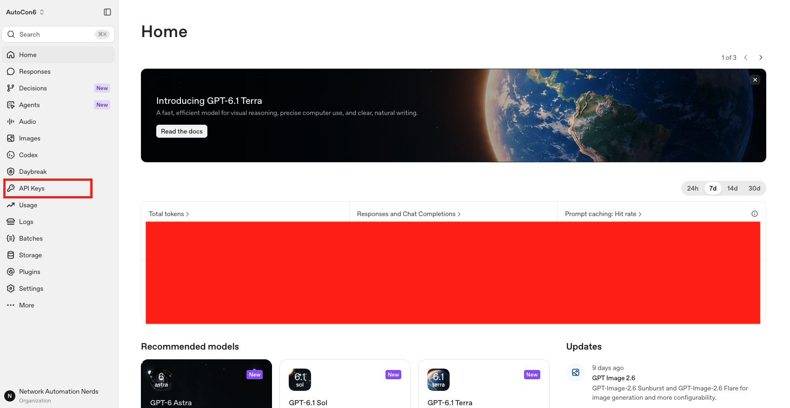

# AutoCon 6: AI for the Network Forward Engineer

> **Track D1 · Tuesday afternoon · 4 hours · hands-on**
> Eric Chou

> ### 📣 The lab environment is live — read this first
>
> As of **Friday, November 13**, the whole workshop is in this repo: the Codespace configuration, all five labs and the bonus material. *(An earlier version of this page asked you not to create a Codespace yet. That no longer applies.)*
>
> **Everyone, before Tuesday:** work through [Prerequisites](#prerequisites) — GitHub account, OpenAI account with $5 of funded credit, free Arize AX account — and join `#ac6-ws-d1-ai-for-the-network-forward-engineer` on the Network Automation Forum Slack. Read the [FAQ](WORKSHOP_FAQ.md).
>
> **Optional — try it early.** You don't have to: on Tuesday we launch together, and nothing assumes you've seen the labs. If you'd like a head start, follow [Launch your Codespace](#launch-your-codespace) and begin with Lab 1. If you do:
>
> - **Stop your Codespace when you're done for the day** (github.com/codespaces → `...` → **Stop codespace**). The free allowance is about 30 hours a month on the 4-core machine, and the workshop itself needs four of them.
> - **Keep that Codespace for Tuesday** instead of deleting it. It resumes in seconds, with your files as you left them.
> - **On Tuesday, before we start, run `git pull`** in its terminal. We may still fix small things in the lab text before then. If git refuses because of a file you edited, run `git stash` and then `git pull` again.
> - **Hit a problem?** Post it in the Slack channel. Finding it now helps everyone on Tuesday.

This repo is the lab environment for the AC6 "AI for the Network Forward Engineer" workshop. The whole stack — local LLM, network simulator, Python toolchain, chat GUI — runs in a GitHub Codespace you launch with one click. Nothing to install locally beyond a browser.

If you're here on workshop day, jump straight to [**Launch your Codespace**](#launch-your-codespace) below.

> **Tip:** hover over any code block in this README (or any lab README) for a copy button — saves you from selecting the text manually.

## What you'll build

Five labs, each building on the last:

1. **Foundations** — your first calls to a local LLM (Ollama, Qwen3 4B) and a cloud LLM (OpenAI, GPT-6), the *reasoning dial* on both, and your first prompt-engineering experiment on real router output.
2. **Structured Network Data** — Pydantic schemas as a contract with the model: validated, typed output from real `show` commands — and a golden set that becomes your first eval.
3. **LangChain Network Agent** — wrap the parser as a tool, hand it to a LangChain 1.x / LangGraph agent, watch it decide which router to ask, see the same agent as an explicit graph, and trace every run.
4. **Streamlit Frontend** — a chat UI over the agent that *shows its work*: tool calls as they happen, conversation memory, every chat tagged as a session.
5. **Evaluation with Arize AX** — read the traces you produced, run an experiment in Arize with an LLM judge scoring every answer, show that a prompt change helped, and put the agent through hallucination traps it has to pass.

By the end you've built a small but real "network co-pilot" — and the evaluation harness that proves it works. Runs anywhere a Codespace can run.

## Prerequisites

Bring:

- A laptop with **Chrome** (recommended) or a recent Firefox/Edge
- A **GitHub account** — free tier is fine. You need it because the entire lab environment runs in a **GitHub Codespace**; nothing else is installed on your laptop.
- An **OpenAI account** with at least **$5 of prepaid credit** ([sign up here](https://platform.openai.com)). The account needs actual funded credit, not just a sign-up — Lab 1 will fail with a `RateLimitError` if there's no balance. The API key you'll copy into the lab environment is created under **API Keys**, in the left-hand menu of the platform's home page.

  

  *Screenshot from 13 November. OpenAI rearranges its menus from time to time; if yours looks different, look for **API Keys**.*
- A **free Arize AX account** ([sign up here](https://app.arize.com)) — used in Lab 5 to trace and evaluate your agent. Free tier is fine. After signing up, open **Settings** in Arize and locate the two values you'll copy into the lab environment: the **Copy Space ID** button at the top right (shown here on the **Space Members** page), and **API Keys** under **Account Settings** in the left-hand menu.

  

  *Screenshot from 13 November. Arize rearranges its menus from time to time; if yours looks different, look for the same two names.*

Have (we're not teaching these):

- Intermediate Python — read and edit a script, understand a class definition, run `python foo.py`
- Networking basics — BGP, OSPF, route tables. We use them as examples; we don't explain them.

See [WORKSHOP_FAQ.md](WORKSHOP_FAQ.md) for the full pre-workshop checklist.

## Launch your Codespace

1. Click the green **Code** button at the top of this page.
2. Switch to the **Codespaces** tab → **Create codespace on main**.
3. When prompted for machine type, pick **4-core / 16 GB / 32 GB** (the free tier). The 2-core tier doesn't have enough memory for SR Linux + Ollama + the rest of the stack.
4. Wait **5-8 minutes** for the first boot, and be patient: **there is no progress bar**, and nothing on screen to tell you how far along it is. It is working. The image is pulled once; subsequent restarts of the same Codespace are much faster.
5. When the editor has loaded, confirm that setup finished: open the **Command Palette** (`Ctrl+Shift+P`, or `Cmd+Shift+P` on a Mac) → **Codespaces: View Creation Log**. The log only becomes available once the Codespace has loaded. Near its end you should find the **welcome banner** (it starts with `==================================================` and ends with sanity-check commands). The banner confirms the SR Linux image loaded — that's how you know the Codespace finished setup successfully. You may also see the same banner in the terminal, but don't wait for it there: it only shows up if the editor happened to connect before setup finished.
6. VS Code's **Ports** panel (bottom of the screen) starts **empty** — that's normal. Ports appear as the labs start the services behind them: **11434 (Ollama API)** shows up once you start Ollama in Lab 1, and **8501 (Streamlit)** auto-opens a preview when you run the app in Lab 4.
7. Start with [**Lab 1**](Lab_1_Foundations/README.md).

> **Want a snappier experience? (optional — GitHub Pro)** The default above is free and runs every lab. If you have GitHub Pro (or any plan that allows a larger machine), there's a second configuration — *"AutoCon 6 AI Workshop — GitHub Pro (larger machine)"* — that runs on an **8-core / 32 GB** machine (noticeably faster, especially Lab 3's live network sim + local LLM running together) and adds the **Open WebUI** chat GUI (Lab 1 Step 8). Pick it via **Codespaces → ⋯ → New with options…** → the **Dev container configuration** dropdown. Purely optional — the free default is fully sufficient.

## Workshop day — how we'll run the session

The Codespace takes 5–8 minutes to build on first boot, so on workshop day we'll start it right away and use the wait productively. Here's the opening sequence we'll do together:

1. **Join the Slack channel first.** `#ac6-ws-d1-ai-for-the-network-forward-engineer` in the Network Automation Forum Slack is where we handle real-time questions, stalled builds, and anything that's easier to paste than to say out loud. Join it now so you can reach us without leaving your seat.
2. **Everyone kick off your Codespace now.** Follow [Launch your Codespace](#launch-your-codespace) above. Expect 5–8 minutes with **no progress bar** to watch, so be patient: it is working. If the build sits much longer than 8 minutes, shows an error, or lands in the **"recovery mode"** dialog, flag it now (hand up or post in the channel) while we can fix it together, not 20 minutes in. After the editor opens, **Command Palette → "Codespaces: View Creation Log"** shows the creation log — that's where to confirm `postCreate.sh` finished and the SR Linux image loaded. The welcome banner is near the end of it.
3. **No OpenAI account yet?** While the image builds, head to [platform.openai.com](https://platform.openai.com), create an account, and **add the $5 prepaid credit** (see [Prerequisites](#prerequisites) — Lab 1 fails without funded credit). Takes a couple of minutes; the build runs in the background.
4. **Optional — want to try Anthropic too?** If you'd like to compare Claude against OpenAI later (Lab 1's "Going further" #5), grab an Anthropic API key now at [console.anthropic.com](https://console.anthropic.com) — they include $5 in starter credits. Purely optional; OpenAI is all you need for the core labs.
5. **Still building?** Good — we'll start the **Lab 1 "Concepts" section** together while the image finishes. No need for a running Codespace to follow along with the concepts; by the time we reach the first hands-on step, your environment will be ready.

## A note on Codespaces billing

Short answer: **a 4-hour workshop on a free GitHub account does not cost you anything.**

Longer answer: GitHub gives every personal account ~120 core-hours of Codespace runtime per month, free. The 4-core machine we recommend uses 4 core-hours per actual hour of runtime, so a 4-hour workshop session burns ~16 core-hours — well inside the free allowance for most people. Storage is the same story: 15 GB free per month, our image is well under that.

That said: **stop your Codespace when you're done** to avoid leaving the meter running. GitHub UI → Codespaces → click the `...` next to yours → **Stop codespace**. (Or just close the browser tab; GitHub auto-stops after 30 min of inactivity by default.)

If you want a fresh environment for any reason, **delete** the Codespace instead of stopping it. Same menu, "Delete." Next launch pulls the image fresh.

## What's running inside the Codespace

When you boot, you get:

- **Python 3.11** with LangChain 1.x, LangGraph, the OpenAI SDK, Pydantic, Streamlit, and the Arize AX tracing/evaluation stack (`arize`, `arize-otel`, OpenInference) pre-installed
- **Ollama** with `qwen3:4b-q4_K_M` already pulled into the image — a hybrid model whose thinking mode you can switch on and off; no model download needed at boot
- **Open WebUI** v0.9.5 — chat GUI for Ollama on port 8080 *(GitHub Pro image only; the default image uses the `ollama run` CLI instead)*
- **Containerlab** 0.74.3 for spinning up the network topology
- **SR Linux** 25.10.2 image baked in — three nodes (`r1`, `r2`, `r3`) running OSPF + iBGP + eBGP
- All the **lab content** — READMEs and pre-built Python scripts for each lab

## Topology

The topology you'll deploy in Labs 3-4:

```
            AS 65002 (external)
            ┌──────┐
            │  r3  │
            └───┬──┘
                │ eBGP (10.1.13.0/30)
            ┌───┴──┐                          ┌──────┐
            │  r1  │── OSPF + iBGP ────────── │  r2  │
            └──────┘                          └──────┘
                       AS 65001 (internal)
```

Three SR Linux nodes. `r1` and `r2` are in the same AS and run iBGP over a loopback session, with OSPF as the IGP underneath. `r3` is in a different AS and peers eBGP with `r1`. Realistic enough to demonstrate the patterns, small enough to fit in a Codespace.

## The labs, in order

| # | Lab | What you do | Time |
|---|-----|-------------|------|
| 1 | [Foundations](Lab_1_Foundations/README.md) | Local + cloud LLM calls, the reasoning dial, naive vs few-shot prompting | ~35 min |
| 2 | [Structured Network Data](Lab_2_Structured_Network_Data/README.md) | Pydantic contract, validation + retries, your first eval on a golden set | ~35 min |
| 3 | [LangChain Network Agent](Lab_3_LangChain_Network_Agent/README.md) | Tool, agent, explicit LangGraph, tracing debut, live routers | ~40 min |
| 4 | [Streamlit Frontend](Lab_4_Streamlit_Frontend/README.md) | Chat UI that shows the agent's work; memory; sessions in Arize | ~30 min |
| 5 | [Evaluation with Arize AX](Lab_5_Evaluation_Arize_AX/README.md) | Read traces, a playground experiment scored by an LLM judge, the agent tested with hallucination traps | ~35 min |

Each lab has a short **CONCEPTS.md** we'll go through together before the hands-on part, and a **Going Further** section for early finishers — the labs are built so that nobody waits. The [`bonus/`](bonus/) folder (MCP, real RAG, a provider swap to Anthropic, and a discussion guide) is for after Lab 5 or after the workshop.

## If something goes wrong

**A dialog says "This codespace is currently running in recovery mode due to a configuration error"**
The environment image couldn't be pulled, so GitHub dropped you into a bare fallback container — nothing in it works (no `ollama`, no `containerlab`). This is **on our side, not yours**: it means the workshop image isn't reachable from your account. Don't rebuild or debug; tell a proctor (hand up or Slack) right away. If you want to see for yourself, click **View Creation Log** in that dialog and look for `No manifest found` / `docker pull ... failed` near the top. Once we've fixed the cause, **Command Palette → "Codespaces: Rebuild Container"** (full rebuild) brings the real environment up without deleting anything.

**My Codespace stopped by itself (e.g. during the break)**
Codespaces stop after **30 minutes idle** by default. Resuming is quick (Codespaces → Resume, or just reload the tab) and keeps your files, but **everything you started by hand is gone**: `ollama serve`, the containerlab topology, Streamlit. Restart what the current lab needs — the lab READMEs tell you the commands. To avoid this on workshop day, raise your idle timeout beforehand: [github.com/settings/codespaces](https://github.com/settings/codespaces) → **Default idle timeout** → 240 minutes. The FAQ has the details.

**The Codespace gets stuck at "88% — installing docker-in-docker"**
Common, harmless. Docker is usually already running by the time you see this. Open a new terminal in VS Code and run `docker info` — if you get version info back, the daemon is up and the progress dialog is just stale. Dismiss it.

**I never saw the welcome banner in the terminal**
That's usually fine. Setup writes to the creation log, and the banner only reaches a terminal if the editor connected before setup finished. Open **Command Palette → "Codespaces: View Creation Log"** and scroll to the end: the banner there means setup finished. If the log ends with an error instead, `postCreate.sh` failed. The most common cause is a transient image-load failure — run `docker images` to check whether SR Linux loaded (and Open WebUI too, if you're on the GitHub Pro image).

**(GitHub Pro image) Open WebUI shows up but the model dropdown is empty**
Ollama isn't running yet. In any terminal: `ollama serve > /tmp/ollama.log 2>&1 &`, then refresh the Open WebUI page. (Lab 1 Step 1 covers this.) On the default image there's no Open WebUI — chat from the CLI with `ollama run qwen3:4b-q4_K_M`.

**The local model is slow / seems stuck**
It's a 4-billion-parameter model on four CPU cores: expect ~6 tokens per second, so a two-sentence answer takes about 10 seconds and the first call after `ollama serve` adds 10–20 seconds of model loading. If it's taking *minutes*, you probably left thinking mode on — add `--think=false` on the CLI, or `reasoning=False` in Python (Lab 1 Step 6 explains the dial). Thinking mode on a hard question can genuinely run 10+ minutes locally; Ctrl-C is fine.

**Streamlit's preview pane says "github.com refused to connect", or the page is there but dead**
That pane is VS Code's Simple Browser, and Streamlit doesn't work in it. Open the app in a *real* browser tab instead: in the Ports panel, click the globe icon next to port 8501, or Ctrl-click (Cmd-click on a Mac) the **Local URL** that Streamlit printed in the terminal. The Network and External URLs it also prints are addresses inside the Codespace; your laptop can't reach them.

**`containerlab deploy` fails with "User 'vscode' is not part of containerlab admin group"**
That group membership is baked into the image, so this shouldn't happen on a fresh Codespace. If it does, run `sudo usermod -aG clab_admins vscode && newgrp clab_admins` and retry.

**`containerlab deploy` prints warnings, such as `iptables check error: exit status 111`**
Harmless. The Codespace runs Docker inside Docker, and containerlab's firewall-rule check doesn't work in that setup. You may also see deprecation warnings about the routers' node type. We saw both on our own deploys in a Codespace (8 November 2026), and the three routers came up and peered normally every time. What matters is the table at the end: if it lists `clab-autocon6-r1`, `r2` and `r3` as `running`, carry on.

**After `containerlab deploy`, r1's eBGP session to r3 shows `active`**
For the first 15–30 seconds after deploy that's normal — r3 finishes booting after the iBGP session is already up. Wait and re-check. If it's *still* not `established` after a minute, look at r3's own table; if it's empty, r3's startup config lost its neighbor line (seen occasionally on SR Linux 25.10). Put it back live:
```bash
docker exec clab-autocon6-r3 sr_cli -ec "set / network-instance default protocols bgp neighbor 10.1.13.1 peer-group ebgp-r1"
```
Lab 3 Step 6 walks through this in context.

**`[tracing] ARIZE_SPACE_ID / ARIZE_API_KEY not set` — or traces don't show up in Arize**
Open `.env` and confirm both values are filled (in Arize's **Settings**, the Space ID is the **Copy Space ID** button and the API key is under **Account Settings → API Keys**; the screenshot under [Prerequisites](#prerequisites) shows both. The API key is long — make sure the whole thing pasted). If the keys are set but the project never appears, check the terminal for a connection error right after the `[tracing]` line, and give it a minute: spans are sent in batches. Labs 3–5 all work without tracing; you just won't have anything to evaluate in Lab 5.

**Streamlit's status box never collapses / the app looks frozen**
Almost always the Simple Browser problem above. Open port 8501 in a real browser tab.

**The editor stops responding, or shows "Reconnecting…"**
Your browser lost its connection to the Codespace; the Codespace itself is still running, and your files are as you left them. Wait half a minute. If it doesn't come back, open the Command Palette and run **Developer: Reload Window**, or reload the browser tab. Afterwards, check your terminals and restart anything that is no longer running. (We saw this once in our own walkthrough, just after stopping Streamlit with `Ctrl+C` at the end of a long stretch of local-model use.)

**I edited a lab file and want the original back**
Every lab script is in the repo in its finished form, so git can restore it:
```bash
git status                                              # lists the files you've changed
git checkout -- Lab_4_Streamlit_Frontend/chat_app.py    # restore one file
git checkout -- Lab_4_Streamlit_Frontend/               # restore a whole lab folder
```
This discards your edits to those files and touches nothing else. Your `.env` is not tracked by git, so your keys are safe.

**OpenAI calls fail with `AuthenticationError`**
Your API key isn't loading. Open `.env` in the file explorer and confirm `OPENAI_API_KEY=sk-...` is there, with no quotes or trailing spaces.

**OpenAI calls fail with `RateLimitError` / "insufficient quota"**
Your key is valid but the account has no credit. Add at least $5 at [platform.openai.com/settings/organization/billing](https://platform.openai.com/settings/organization/billing).

**Nothing above helps — start fresh**
Delete the Codespace (GitHub UI → `...` → Delete) and create a new one. The image is built to be reproducible — a fresh Codespace is the cheapest test of "is the problem me or my environment."

## Getting help

- **During the workshop:** raise a hand — **Eric Chou** and **Adam Byczkowski** are proctoring in the room — or post in `#ac6-ws-d1-ai-for-the-network-forward-engineer` on the Network Automation Forum Slack. The channel is the fastest way to share an error message or a screenshot.
- **After the workshop:** the same Slack channel. (This repo goes private a few days after the workshop, so the channel, not GitHub issues, is the place for follow-up questions.)

## License

Apache 2.0 — see [LICENSE](LICENSE) and [NOTICE](NOTICE).

By Eric Chou — Copyright 2026 Eric Chou and Network Automation Nerds, LLC.
